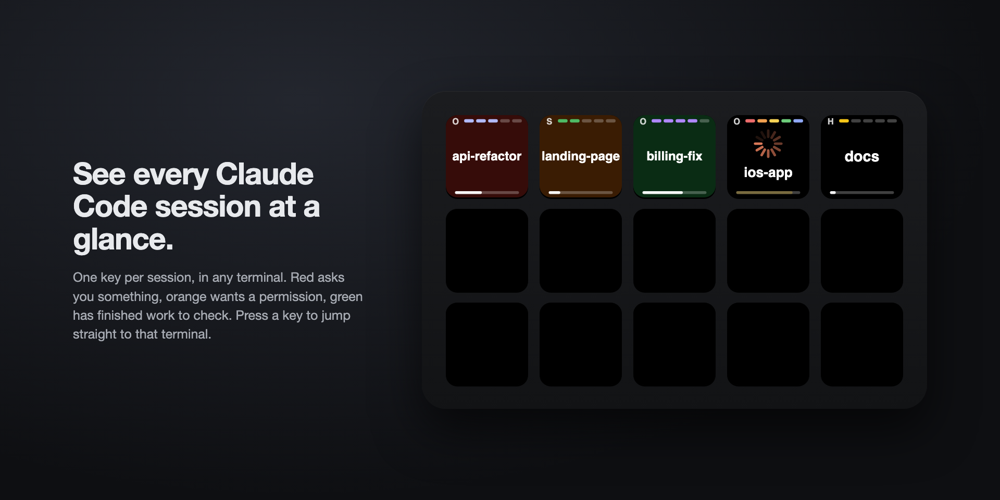
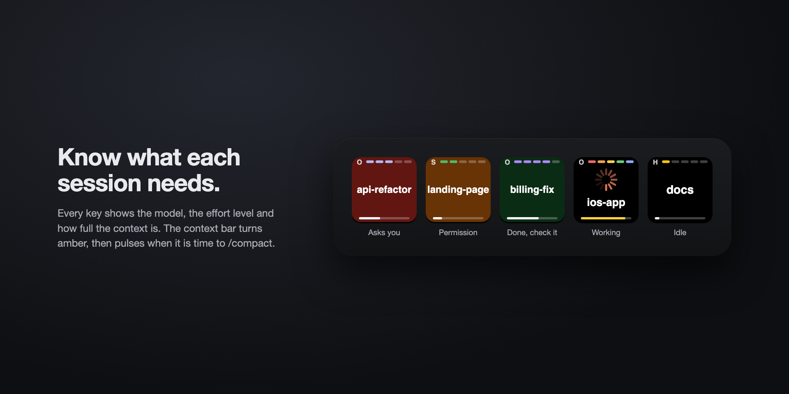
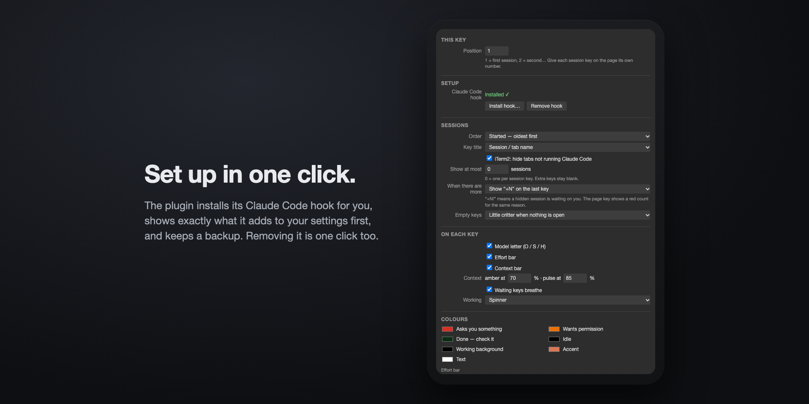

# Session Status for Claude Code — Stream Deck plugin

One Stream Deck key per [Claude Code](https://claude.com/claude-code) session, coloured by what that session needs from you. Press a key to jump straight to that terminal.

Works with whatever terminal you use: iTerm2, Terminal, Ghostty, Warp, WezTerm, kitty, Alacritty, and the VS Code / Cursor terminal.



| Key | Meaning |
|---|---|
| Red (breathing) | Claude asked you a question or wants a plan approved |
| Orange (breathing) | Claude is waiting on a permission prompt |
| Green | Claude finished something you should check or try |
| Spinner | Claude is working |
| Dark | Idle |

Each key also shows the model (O / S / H), the effort level, and how full the context window is. The context bar turns amber, then pulses when it is time to `/compact`.



## Install

1. Download `io.github.jacopopiogargano.ccstatus.streamDeckPlugin` from the [latest release](../../releases/latest) and double-click it.
2. Drag the **Session** action onto as many keys as you want, and give each one a position (1, 2, 3…) in its settings.
3. In the settings of any Session key, click **Install hook…**. It shows the exact entries it will add to `~/.claude/settings.json`, saves a backup, and only writes after you confirm.
4. Start (or restart) your Claude Code sessions.

**Remove hook** in the same panel takes out only this plugin's entries.

## Requirements

- macOS 12+, Stream Deck app 6.9+
- Any terminal app (see below for what pressing a key does in each)
- `/usr/bin/python3` (run `xcode-select --install` if it is missing)

## Pressing a key

| Terminal | Jumps to |
|---|---|
| iTerm2 | the exact window, tab and split pane |
| Terminal | the exact window and tab |
| WezTerm | the exact pane |
| Ghostty, Warp, kitty, Alacritty, VS Code, Cursor, others | brings that app to the front |

## Settings

All in the key's settings panel:

- **Order:** oldest first, newest first, tab order, needs-you first, most recently active, or by name
- **How many:** show at most N sessions; key title from the tab name or the project folder; in iTerm2, hide tabs not running Claude Code
- **More sessions than keys:** a "+N" badge on the last key (with "!" if a hidden session needs you), a page key that flips through them, or keep the sessions that need you visible
- **On each key:** model letter, effort bar and context bar on/off; context warning thresholds; breathing; spinner or still
- **Colours:** every state colour, the accent, the text, and the effort colours (rainbow on max, or your own)
- **Smart status (off by default):** after each reply, ask Haiku whether it needs you. This runs `claude -p --model haiku` and uses your Claude plan. When off, a quick keyword check decides.



## How it works

- `src/hook.py` is a Claude Code hook (shipped inside `bin/hook-src.js`; run `node tools/embed-hook.js` after editing it). The installer writes it to `~/.claude/session-status/hook.py`, and it writes one small JSON file per session to `~/.claude/session-status/`, including which terminal app, tty and process the session runs in.
  - The hook command ends in `|| true`, so it never blocks Claude Code, even if the plugin is uninstalled.
  - Nothing leaves your machine, except the optional Haiku check, which goes through your own `claude` CLI.
- `bin/plugin.js` reads those files (plus the iTerm2 tab list via AppleScript, so tabs keep their order) and draws the keys. A session disappears when its `claude` process exits.

See [PRIVACY.md](PRIVACY.md) for exactly what the plugin reads and writes.

## Development

```sh
npx @elgato/cli validate io.github.jacopopiogargano.ccstatus.sdPlugin
npx @elgato/cli pack io.github.jacopopiogargano.ccstatus.sdPlugin -o dist
node tools/screenshots.js     # redraw the screenshots (needs Google Chrome)
node tools/make-icons.js io.github.jacopopiogargano.ccstatus.sdPlugin
node io.github.jacopopiogargano.ccstatus.sdPlugin/bin/hooks.js status --settings /path/to/test-settings.json
```

## Disclaimer

This is an independent project. It is not made by, affiliated with, or endorsed by Anthropic. "Claude" and "Claude Code" are trademarks of Anthropic.

## License

MIT
